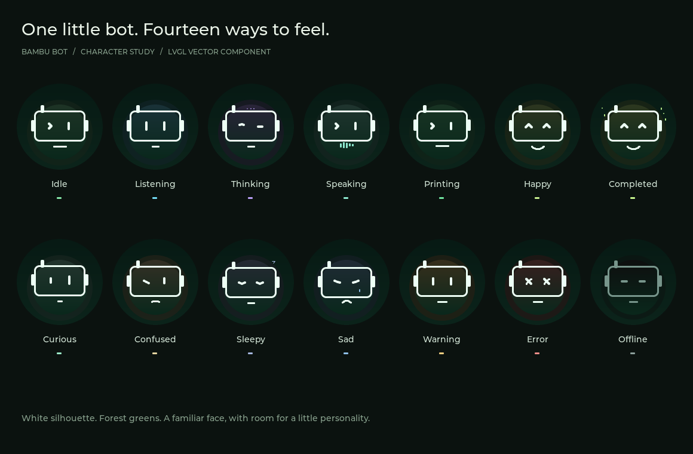

# Bambu Bot

Robot chatbot để bàn theo dõi Bambu Lab A1, phát triển trên [XiaoZhi](https://github.com/78/xiaozhi-esp32).

## Giao diện và emotion trên macOS

Đã có **Bambu Bot Emotion Studio** dùng LVGL 9.5.0 + SDL2: 14 emotion có animation, hai kích thước LCD 280×240 / màn tròn 466×466, thanh tiến độ và chế độ chạy tự động.

```sh
brew install cmake ninja sdl2
./scripts/run_simulator.sh
```



Studio **0.3.2** bổ sung [18 kịch bản 3D](docs/3D_SCENES.md) chỉ phần đầu robot, với chuyển 2D → 3D, đạo cụ động và hai theme. Mở bằng nút **3D scenes** hoặc phím **D**; đây là bản thử nghiệm simulator.

Xem [hướng dẫn Studio](docs/UI_STUDIO.md). Renderer nằm trong `ui/`, tách khỏi SDL để dùng lại trên ESP32; đã tích hợp vào firmware **v0.2.0** cho Desk-bot 280×240.

## Bản thử nghiệm hiện tại

Dùng phần cứng Desk-bot có sẵn: **ESP32-S3, màn ST7789 240×280, mic I2S và loa I2S**. Đây là cấu hình test trước khi chuyển sang Waveshare AMOLED 1.75.

Từ Desk-bot chỉ nhập nguyên file định nghĩa phần cứng vào [`main/boards/bambu-deskbot/config.h`](main/boards/bambu-deskbot/config.h). Không nhập mã ứng dụng, camera, theo dõi khuôn mặt, GIF hay cấu hình dịch vụ của Desk-bot. Nền phần mềm lấy trực tiếp từ repo XiaoZhi gốc tại commit `49ac8a6da399f27a9546d4f73640b7f86c24bac6` (v2.2.6), phù hợp ESP-IDF 5.5.4 đang cài trên máy.

| Đã triển khai trong mã | Giới hạn hiện tại |
| --- | --- |
| Nền hội thoại XiaoZhi, 14 emotion LVGL, BOOT bật/tắt hội thoại | Cần cấu hình server và kiểm tra mic/loa thực tế |
| Demo tiến độ A1, mỗi chu kỳ 120 giây; icon nhiệt độ và hai theme LCD | Không phải dữ liệu máy in thật |
| MQTT TLS đọc trạng thái A1 qua LAN | Cần IP, serial, access code và CA PEM; chưa thử với A1 thật |
| MCP `self.bambu.get_printer_status` | Server/model cần hỗ trợ công cụ MCP |
| Gộp bản tin từng phần, tuổi dữ liệu theo trường, chống hoàn tất giả sau reconnect | Chưa lưu chống lặp sự kiện qua reboot |
| Popup và âm báo khi hoàn tất hoặc có `print_error` mới | Chưa có giọng nói thông báo chủ động, giải mã HMS hay RAG Wiki |
| Không tự nạp bản firmware XiaoZhi do server discovery đề nghị | OTA discovery vẫn dùng để lấy cấu hình hội thoại/kích hoạt |

**Servo chưa bật:** `config.h` nguồn không định nghĩa chân servo. Không tự gán chân hoặc bật GPIO đèn mẫu của upstream.

## Build và thử demo

Cần ESP-IDF **5.5.4**, target ESP32-S3, flash 16 MB và PSRAM octal. Dependency được ghim trong `dependencies.lock`.

```sh
. "$HOME/esp/esp-idf/export.sh"
idf.py set-target esp32s3
idf.py build
idf.py -p /dev/cu.YOUR_ESP32_PORT flash monitor
```

Build mặc định chạy demo, không cần cấu hình máy in. Màn 280×240 không có nhãn DEMO theo thiết kế; dữ liệu trong bản build demo này vẫn hoàn toàn giả lập. Chọn đúng cổng serial của board; mic/loa của cấu hình test dùng GPIO19/20 nên lưu ý đây cũng là chân USB native của ESP32-S3. Thực hiện nạp theo cổng USB-UART và cách đấu dây đang có trên Desk-bot, không đổi dây theo sơ đồ Waveshare.

Sau khi nạp, thiết lập Wi-Fi theo luồng XiaoZhi; nhấn BOOT trong lúc khởi động để vào cấu hình khi cần. Nhấn ngắn BOOT khi chạy bình thường bật/tắt hội thoại. **Nhấn giữ BOOT** đổi giữa nền đen/nét xanh Bambu và nền xanh Bambu/nét trắng; lựa chọn được lưu qua khởi động lại. MCP `self.screen.set_theme`: `dark` là đen/xanh, `light` là xanh/trắng. Nếu dùng server mặc định, hoàn tất kích hoạt thiết bị theo mã hiển thị. Giao diện tiếng Việt không tự đặt ngôn ngữ ASR/TTS: cần chọn giọng và cấu hình trợ lý tiếng Việt trên server.

Hỏi “Máy in đang in đến đâu?” và yêu cầu trợ lý gọi `self.bambu.get_printer_status`. Trong demo, trợ lý phải nói rõ dữ liệu giả lập. Có prompt tham khảo trong [hướng dẫn test](docs/TESTING.md).

## Kết nối A1 thật

```sh
cp bambu.example.json bambu.local.json
# Chỉnh file cục bộ: demo=false, host, serial, access_code, ca_file
python3 scripts/configure.py bambu.local.json
idf.py build
idf.py -p /dev/cu.YOUR_ESP32_PORT flash monitor
```

`bambu.local.json`, CA PEM và header sinh ra đều bị Git bỏ qua. Không chia sẻ firmware build với thông tin xác thực cá nhân. Lấy CA PEM phù hợp từ nguồn tin cậy của cấu hình máy in; client kiểm tra chuỗi chứng chỉ bằng CA cung cấp, bỏ kiểm tra hostname vì kết nối bằng IP. Chưa có chế độ tự khám phá máy in hoặc thu thập chứng chỉ.

Chỉ subscribe `device/<serial>/report` và gửi yêu cầu telemetry `pushall`; không gửi lệnh điều khiển in. Dữ liệu không có là `null`, trường quá 30 giây được đánh dấu stale. Cần kiểm tra firmware/cấu hình LAN A1 cho phép truy cập MQTT.

Để quay lại demo: đặt `demo=true` trong file cục bộ và chạy lại `configure.py`, hoặc xóa `main/bambu/local_config.h`, rồi build/nạp lại.

## Server AI

Có thể thử với dịch vụ discovery mặc định của XiaoZhi, hoặc tự host [xiaozhi-esp32-server](https://github.com/xinnan-tech/xiaozhi-esp32-server). Dự án này chưa đóng gói hay triển khai server.

Với server riêng, đặt `ota_url` trong file cục bộ thành URL **OTA discovery của server XiaoZhi**, không phải URL WebSocket hay file firmware. Khi khởi động, giá trị được ghi vào NVS `wifi/ota_url`. Xóa giá trị trong JSON không xóa cấu hình NVS cũ; đổi sang URL mong muốn và tạo lại header. Robot vẫn dùng discovery để lấy endpoint hội thoại nhưng bỏ qua đề nghị cập nhật firmware tự động, tránh bị thay bằng firmware upstream.

## Kiểm tra và tài liệu

```sh
python3 scripts/test_host.py
```

Host test biên dịch chính parser firmware với AddressSanitizer/UndefinedBehaviorSanitizer; dùng cJSON có sẵn trong ESP-IDF, hoặc `libcjson-dev` qua pkg-config. CI chạy kiểm tra này trên GitHub.

- [Hướng dẫn thử nghiệm và trạng thái kiểm chứng](docs/TESTING.md)
- [Nguồn mã và nguồn định nghĩa phần cứng](docs/UPSTREAM.md)
- [Thiết kế sản phẩm đầy đủ](docs/PROJECT_PLAN.md) — phần kiến trúc mục tiêu, gồm AMOLED, Wiki và servo ở các giai đoạn sau.

Tham khảo giao thức/trạng thái từ [PrintSphere](https://github.com/cptkirki/PrintSphere). Client A1 trong bản này được viết riêng; không chép mã PrintSphere. Nếu tích hợp mã upstream đó về sau, cần tuân theo [giấy phép FNCL v1.1](https://github.com/cptkirki/PrintSphere/blob/main/LICENSE).
