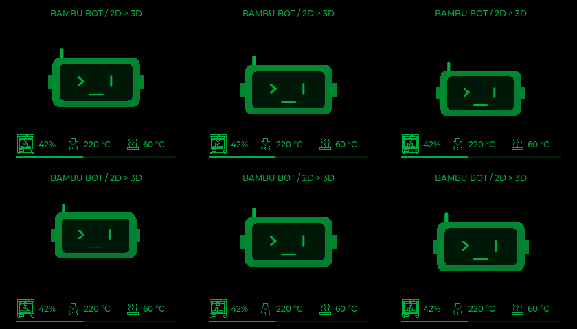
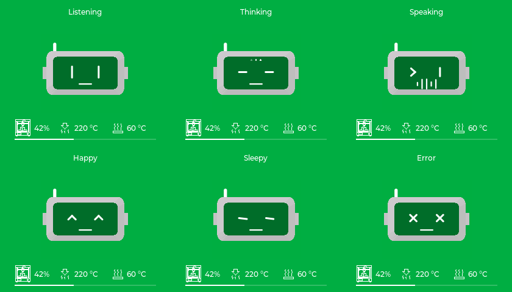
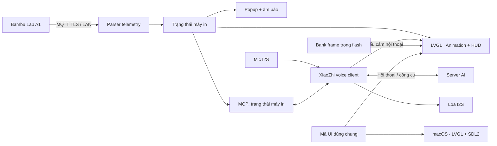

<div align="center">

# 🤖 Bambu Bot

### Trợ lý AI để bàn dành cho góc in 3D của bạn

**Bambu Lab A1 · Hội thoại XiaoZhi · LVGL Emotion Studio · 3D Head Animation · LAN MQTT · MCP**

[](https://www.espressif.com/en/products/socs/esp32-s3)
[](https://github.com/espressif/esp-idf)
[](https://lvgl.io/)
[](https://github.com/Hdchipeo/bambu-bot/releases)
[](https://github.com/Hdchipeo/bambu-bot/actions/workflows/host-tests.yml)
[](https://github.com/Hdchipeo/bambu-bot/actions/workflows/simulator.yml)
[](LICENSE)

**[Tính năng](#features) · [Emotion Studio](#studio) · [Bắt đầu](#quick-start) · [Kết nối A1](#printer) · [Kiến trúc](#architecture) · [Phần cứng](#hardware) · [Tài liệu](#documentation)**

<br />



*Preview từ simulator macOS · Robot chỉ có phần đầu và các đạo cụ theo kịch bản*

</div>

---

## Tổng quan

**Bambu Bot** là robot chatbot để bàn giúp bạn theo dõi máy in **Bambu Lab A1**, hỏi trạng thái bản in bằng giọng nói và tương tác với một đầu robot có biểu cảm. Dự án kết hợp nền hội thoại [XiaoZhi](https://github.com/78/xiaozhi-esp32), giao diện **LVGL** và dữ liệu máy in qua **MQTT TLS trong mạng LAN**.

Bản mẫu hiện dùng phần cứng **Desk-bot ESP32-S3 + LCD 280×240**. **Emotion Studio trên macOS** dùng chung mã UI để thử bố cục, theme và animation trước khi nạp lên thiết bị. Firmware **0.5.0** bổ sung thông báo chủ động qua giọng nói mô phỏng, giải mã HMS và tra cứu Bambu Wiki qua MCP/RAG trên Mac. Màn AMOLED và chuyển động servo nằm trong lộ trình phát triển.

<a id="features"></a>

## 🌟 Tính năng

| Khả năng | Đã triển khai | Trạng thái / giới hạn |
| :--- | :--- | :--- |
| **Hội thoại AI** | Mic/loa I2S, wake word, hội thoại qua XiaoZhi | Cần thiết lập server, kích hoạt và chọn ASR/TTS phù hợp |
| **Theo dõi A1 qua LAN** | Tiến độ, nhiệt đầu phun/bàn nhiệt, trạng thái in qua MQTT TLS | Đã xác nhận telemetry với A1 thật; chưa kiểm thử chạy dài |
| **Đầu robot 3D** | 18 kịch bản, 14 biểu cảm phần đầu, hai theme | LCD 280×240 dùng frame dựng sẵn; nhịp mục tiêu 20 FPS chưa được đo trên thiết bị |
| **Emotion Studio** | LVGL 9.5.0 + SDL2; màn chữ nhật 280×240 và màn tròn 466×466 | Màn tròn trong simulator dùng renderer CPU |
| **Giao diện máy in** | Icon máy in, đầu phun, bàn nhiệt và tiến độ; màu xanh `#00AE42` | HUD LVGL độc lập với animation, cập nhật theo telemetry |
| **Công cụ MCP** | `self.bambu.get_printer_status` để trợ lý đọc trạng thái | Server/model AI cần hỗ trợ gọi công cụ |
| **Thông báo sự kiện** | Giọng nói chủ động khi bắt đầu/hoàn tất/lỗi, dùng Opus mô phỏng theo cơ chế Smart-lamp; popup/âm báo dự phòng | Chờ trợ lý Idle, chống lặp/huỷ thông báo cũ; chưa kiểm tra ASR/TTS trên thiết bị ở bản mới |
| **HMS & Wiki RAG** | Giải mã HMS, tra catalog lỗi chính thức và Wiki cục bộ qua MCP | Backend SQLite FTS5 trên Mac; cần cấu hình và prompt trợ lý, chưa có embedding/reranker |
| **Kiểm soát dữ liệu cũ** | Gộp bản tin từng phần, theo dõi tuổi từng trường, chống hoàn tất giả sau reconnect | Chưa lưu chống lặp sự kiện qua reboot |

<a id="studio"></a>

## 🎭 Emotion Studio & animation

### Chạy thử trên macOS

```sh
brew install cmake ninja sdl2
./scripts/run_simulator.sh
```

| Điều khiển | Chức năng |
| :--- | :--- |
| **D / 3D scenes** | Chọn 18 kịch bản có đạo cụ |
| **E / 3D heads** | Chọn 14 biểu cảm chỉ có đầu robot |
| **T** | Đổi theme đen/xanh Bambu ↔ xanh Bambu/trắng |
| **R** | Đổi màn chữ nhật / màn tròn |
| **M** | Dừng / tiếp tục animation |
| **B** | Phát lại đoạn mở đầu |
| **← / →** | Chọn cảnh hoặc biểu cảm trước / sau |
| **Space** | Bật / tắt trình tự phát tự động |

```sh
./scripts/run_simulator.sh --all-demo
./scripts/run_simulator.sh --heads-demo
```

### 18 kịch bản · 14 biểu cảm · 2 theme

**Kịch bản:** chơi game, uống cà phê, nghe nhạc, khám phá, ngủ gật, ruồi bay qua, kiểm tra máy in, hoàn tất bản in, đua xe, uống trà sữa, chill, máy in lỗi, nhảy disco, chăm cây, máy bay giấy, ảo thuật, thư giãn và chào người dùng.

**Biểu cảm:** Idle · Listening · Thinking · Speaking · Printing · Happy · Completed · Curious · Confused · Sleepy · Sad · Warning · Error · Offline.

<div align="center">
  
</div>

Firmware luân phiên **15 cảnh vui** khi idle, mỗi 12 giây. Cảnh máy in đang in, hoàn tất hoặc lỗi được chọn theo dữ liệu máy in xác nhận. Khi nghe/nói, robot ưu tiên biểu cảm hội thoại và ẩn đạo cụ idle. Biểu cảm AI không tự tạo sự kiện máy in.

Xem [hướng dẫn Studio](docs/UI_STUDIO.md), [toàn bộ preview và kiến trúc animation](docs/ANIMATION_BANK.md). Hai thử nghiệm ban đầu [Coffee](docs/COFFEE_PLAYBACK.md) và [Printer check](docs/PRINTER_PLAYBACK.md) được giữ làm tài liệu tham khảo.

<a id="quick-start"></a>

## 🚀 Bắt đầu

### 1. Chuẩn bị

- **ESP-IDF 5.5.4**, target ESP32-S3; dependency ghim trong [`dependencies.lock`](dependencies.lock).
- Board **16 MB flash, 8 MB octal PSRAM**, LCD và âm thanh theo [cấu hình phần cứng](main/boards/bambu-deskbot/config.h).
- Cáp USB dữ liệu và cổng **USB-UART** của Desk-bot. GPIO19/20 đang dùng cho âm thanh, cũng là chân USB native của ESP32-S3.

### 2. Tải mã nguồn và build

```sh
git clone https://github.com/Hdchipeo/bambu-bot.git
cd bambu-bot
. "$HOME/esp/esp-idf/export.sh"
idf.py set-target esp32s3
idf.py build
```

Chỉ chạy `set-target` khi thiết lập checkout mới; thao tác này có thể đặt lại cấu hình `menuconfig` của bản build đang dùng.

Checkout mới chạy **demo dữ liệu A1** khi chưa có cấu hình LAN riêng. Tiến độ demo lặp theo chu kỳ 120 giây. LCD 280×240 không hiện chữ “Demo”, nên hãy kiểm tra profile build khi đánh giá dữ liệu.

### 3. Nạp và thiết lập hội thoại

```sh
idf.py -p /dev/cu.YOUR_ESP32_PORT flash monitor
```

Thay cổng serial bằng cổng thực tế. Lệnh `flash` nạp cả app và `generated_assets.bin`; cần giữ hai file cùng bản để dùng decoder và bank animation tương ứng.

Sau khi nạp, thiết lập Wi-Fi theo luồng XiaoZhi và hoàn tất kích hoạt bằng mã hiển thị nếu server yêu cầu. Nhấn BOOT lúc khởi động để vào cấu hình khi cần.

| Thao tác | Chức năng |
| :--- | :--- |
| Nhấn ngắn **BOOT** khi chạy | Bật / tắt hội thoại |
| Nhấn giữ **BOOT** | Đổi theme; lưu lựa chọn qua khởi động lại |
| MCP `self.screen.set_theme` | `dark`: đen/xanh · `light`: xanh/trắng |

Thông báo giọng nói và Wiki RAG cần thêm [cấu hình backend/prompt trợ lý](docs/VOICE_HMS_RAG.md).

Muốn hội thoại tiếng Việt, chọn ngôn ngữ ASR, TTS và prompt trợ lý trên server. Ngôn ngữ giao diện không tự thay cấu hình giọng nói.

### Custom wake word

Với ESP32-S3 / 8 MB PSRAM, **MN7 English** là lựa chọn ưu tiên khi bật custom wake word theo tiếng Anh. Bộ assets mới đã build thành công cùng custom wake word + MN7. MultiNet không phải model tiếng Việt; cụm “bam bu” cần thử nhận dạng thực tế khi quạt/máy in đang chạy. Xem [so sánh model và ngân sách bộ nhớ](docs/ANIMATION_BANK.md#custom-wake-word-và-multinet).

<a id="printer"></a>

## 🖨️ Kết nối Bambu Lab A1

```sh
cp bambu.example.json bambu.local.json
# Chỉnh file cục bộ: demo=false, host, serial, access_code, ca_file
python3 scripts/configure.py bambu.local.json
idf.py build
idf.py -p /dev/cu.YOUR_ESP32_PORT flash monitor
```

Nếu dùng **BMCU** với firmware cũ, đặt `"bmcu_mode": true` để bỏ riêng HMS tương thích `0500-0400-0001-0044`; xem [ngoại lệ BMCU](docs/VOICE_HMS_RAG.md#bmcu-thay-cho-ams).

Điền IP, serial, access code và CA PEM phù hợp với máy in của bạn. Client xác thực chuỗi chứng chỉ bằng CA cung cấp, bỏ kiểm tra hostname vì kết nối bằng IP. Cần bảo đảm firmware/cấu hình LAN A1 cho phép MQTT; hiện chưa có tự khám phá máy in hoặc thu thập chứng chỉ.

`bambu.local.json`, CA PEM và header sinh ra được Git bỏ qua. **Binary build với cấu hình LAN chứa thông tin xác thực cá nhân; không đưa lên release công khai.**

Robot subscribe `device/<serial>/report` và gửi yêu cầu telemetry `pushall`. Bản hiện tại không gửi lệnh điều khiển in. Trường chưa có dữ liệu là `null`; trường quá 30 giây được đánh dấu stale.

> **Thử bằng giọng nói:** “Máy in đang in đến đâu?” — cấu hình trợ lý gọi `self.bambu.get_printer_status`. Khi dùng demo, trợ lý cần nói rõ dữ liệu giả lập.

Để quay lại demo, đặt `demo=true` và chạy lại `configure.py`, hoặc xóa `main/bambu/local_config.h`, rồi build/nạp lại. Xem [hướng dẫn thử nghiệm](docs/TESTING.md) để kiểm tra live/stale/offline và prompt mẫu.

<a id="architecture"></a>

## 🧩 Kiến trúc & bộ nhớ



LCD **280×240** dùng frame dựng sẵn thay cho dựng hình 3D mỗi frame trên ESP32. Bank v3 lưu chung hình dạng của hai theme và bảng màu RGB565 riêng, nén zlib **không mất dữ liệu**. Mỗi frame độc lập; bỏ frame trễ theo thời gian thay vì tạo hàng đợi. HUD nhiệt độ, chữ và tiến độ vẫn do LVGL vẽ riêng.

| Thành phần | Dung lượng / hành vi hiện tại |
| :--- | :--- |
| **Bank animation v3** | **3.602.446 byte**, 32 clip × 2 theme, 5.756 tham chiếu frame |
| **Hai buffer RGB565 dùng chung** | **136.160 byte**, không tăng theo số cảnh |
| **Ba câu thoại mô phỏng** | **90.222 byte** trong assets, Opus 16 kHz / 60 ms |
| **Scratch giải mã palette** | **34.886 byte**, dùng lại giữa các frame |
| **Assets với custom wake word + MN7 English** | **7.374.642 byte**, còn **1.013.966 byte** trong phân vùng 8 MiB |
| **App cùng cấu hình MN7** | **0x359140 byte**, còn **15%** slot ứng dụng |
| **Nhịp phát mục tiêu** | **50 ms/frame → 20 FPS**; chưa đo FPS LCD khi chạy đồng thời MN7 |
| **Dự phòng** | Thiếu/hỏng bank → renderer CPU 140×120, target 100 ms/frame |

Dung lượng trên thuộc build đã kiểm tra với cấu hình model tương ứng; thay model/font sẽ thay kích thước assets. Giữ nguyên bảng phân vùng **hai slot OTA + assets 8 MiB**, NVS và pinout. Kiểm tra dung lượng assets chạy trước khi flash để chặn gói vượt phân vùng.

<a id="hardware"></a>

## 🔧 Phần cứng

| Thành phần | Bản mẫu hiện tại | Hướng phát triển |
| :--- | :--- | :--- |
| **Vi điều khiển** | ESP32-S3 dual-core 240 MHz; flash 16 MB, PSRAM 8 MB | Giữ nền ESP32-S3 |
| **Màn hình** | ST7789 vật lý 240×280, giao diện ngang 280×240, SPI 40 MHz | Waveshare ESP32-S3-Touch-AMOLED-1.75, tròn 466×466 |
| **Âm thanh** | Mic I2S 16 kHz, loa I2S 24 kHz | Mic trên board AMOLED sau khi tích hợp |
| **Điều khiển** | Nút BOOT, backlight LCD | Touch sau khi tích hợp board mới |
| **Servo hai trục** | Chưa bật; cấu hình nguồn không định nghĩa chân servo | Bổ sung sau khi chốt phần cứng |

Nguồn định nghĩa chân là [`main/boards/bambu-deskbot/config.h`](main/boards/bambu-deskbot/config.h), nhập nguyên từ `config.h` của Desk-bot. Không nhập mã ứng dụng, camera hay cấu hình dịch vụ của Desk-bot; không tự gán chân servo hoặc bật GPIO đèn mẫu của upstream. Xem [nguồn phần cứng và phần mềm](docs/UPSTREAM.md).

## 🗣️ Server AI & MCP

Có thể thử với dịch vụ discovery mặc định của XiaoZhi hoặc tự host [xiaozhi-esp32-server](https://github.com/xinnan-tech/xiaozhi-esp32-server). Repo này chứa firmware và simulator; chưa đóng gói hay triển khai server AI.

| Công cụ MCP | Vai trò |
| :--- | :--- |
| `self.bambu.get_printer_status` | Đọc trạng thái máy in cho trợ lý AI |
| `self.bambu.get_notification_context` | Đọc sự kiện vừa kích hoạt thông báo |
| `self.bambu.get_hms_diagnostics` | Đọc HMS/print_error và tra mô tả lỗi, nguồn Wiki |
| `self.bambu.search_wiki` | Tìm đoạn hướng dẫn Wiki theo câu hỏi hoặc mã HMS |
| `self.screen.set_theme` | Chuyển hai theme của Bambu Bot |
| `self.screen.set_brightness` | Chỉnh độ sáng màn hình |
| `self.audio_speaker.set_volume` | Chỉnh âm lượng loa |

Với server riêng, đặt `ota_url` trong JSON cục bộ thành URL **OTA discovery XiaoZhi**, không phải URL WebSocket hoặc file firmware. Khi khởi động, giá trị được ghi vào NVS `wifi/ota_url`; xóa trường JSON không xóa giá trị NVS cũ. Muốn đổi server, đặt URL mong muốn và tạo lại header.

Robot dùng discovery để lấy endpoint/kích hoạt hội thoại, đồng thời bỏ qua đề nghị tự cập nhật firmware upstream để giữ bản Bambu Bot.

## 🧪 Kiểm thử

```sh
# Parser telemetry và kiểm tra cấu hình trên host
python3 scripts/test_host.py

# Build và chạy kiểm thử simulator / codec animation
./scripts/run_simulator.sh --build-only
ctest --test-dir simulator/build --output-on-failure

# Kiểm tra bank trong ảnh assets sau khi build firmware
python3 scripts/verify_animation_assets.py build/generated_assets.bin
```

Parser host được kiểm tra với AddressSanitizer/UndefinedBehaviorSanitizer; dùng cJSON trong ESP-IDF hoặc `libcjson-dev` qua pkg-config. Simulator kiểm tra toàn bộ frame, đổi cảnh/theme, ưu tiên trạng thái, dữ liệu hỏng và fallback. CI chạy [host tests](https://github.com/Hdchipeo/bambu-bot/actions/workflows/host-tests.yml) và [simulator tests](https://github.com/Hdchipeo/bambu-bot/actions/workflows/simulator.yml).

Bank v3 đã đối chiếu **5.756 frame khớp từng pixel RGB565 với bank v2**; Release, ASan/UBSan và build ESP32-S3 + MN7 đã qua. Đây chưa phải kiểm chứng FPS LCD, chất lượng wake word hoặc độ ổn định chạy dài trên thiết bị.

## 📂 Cấu trúc dự án

```text
bambu-bot/
├── main/
│   ├── bambu/                  # Dịch vụ A1, parser telemetry, cấu hình LAN cục bộ
│   ├── boards/bambu-deskbot/    # Pinout, màn hình và tích hợp Desk-bot
│   ├── audio/                  # Mic/loa, wake word và xử lý âm thanh
│   └── display/                # Hạ tầng hiển thị XiaoZhi / LVGL
├── ui/                         # UI dùng chung giữa firmware và simulator
│   ├── animation_assets/       # Bank frame dựng sẵn cho LCD 280×240
│   └── assets/                 # Manifest và tài nguyên UI
├── simulator/                  # Emotion Studio trên macOS / SDL2
├── server/                     # HMS + Wiki retrieval trên Mac (SQLite FTS5)
├── scripts/                    # Cấu hình, tạo assets, kiểm tra và đóng gói
├── tests/                      # Kiểm thử parser, cấu hình và codec
├── partitions/                 # Bảng phân vùng ESP-IDF
└── docs/                       # Hướng dẫn, kiến trúc và preview
```

## 🛠️ Lộ trình

- [x] Hội thoại XiaoZhi và MCP đọc trạng thái máy in.
- [x] Kết nối MQTT TLS và xác nhận telemetry A1 thật.
- [x] Emotion Studio macOS, hai theme và hai kích thước màn hình.
- [x] Đầu robot 3D: 18 kịch bản + 14 biểu cảm, bank v3 vừa flash cùng MN7.
- [x] Popup/âm báo hoàn tất hoặc lỗi máy in.
- [ ] Đo FPS, tải CPU/RAM và độ ổn định khi animation + voice + MQTT cùng chạy.
- [x] Thông báo chủ động bằng Opus mô phỏng, giải mã HMS và Wiki RAG qua MCP trên Mac.
- [ ] Kiểm tra ASR/TTS và thông báo bắt đầu/hoàn tất/lỗi trên Desk-bot với firmware 0.5.0.
- [ ] Tích hợp AMOLED tròn 1.75 và servo hai trục trên phần cứng hoàn chỉnh.
- [ ] Lưu chống lặp sự kiện qua reboot và kiểm thử chạy dài.

<a id="documentation"></a>

## 📚 Tài liệu & nguồn tham khảo

| Tài liệu | Nội dung |
| :--- | :--- |
| [Emotion Studio](docs/UI_STUDIO.md) | Chạy simulator, chọn màn hình, emotion và theme |
| [Voice, HMS & Wiki RAG](docs/VOICE_HMS_RAG.md) | Cơ chế Opus, chính sách thông báo, backend Mac và prompt MCP |
| [Animation bank](docs/ANIMATION_BANK.md) | Preview, codec v3, ngân sách bộ nhớ và chọn MultiNet |
| [Thử nghiệm & kiểm chứng](docs/TESTING.md) | Kết nối, prompt MCP, dữ liệu demo/live/stale |
| [Nguồn upstream](docs/UPSTREAM.md) | Nguồn mã, nguồn định nghĩa phần cứng |
| [Kế hoạch sản phẩm](docs/PROJECT_PLAN.md) | Kiến trúc mục tiêu: Wiki, AMOLED và servo |
| [Releases](https://github.com/Hdchipeo/bambu-bot/releases) | Các bản firmware demo và simulator đã đóng gói |

Nền firmware lấy từ [XiaoZhi ESP32](https://github.com/78/xiaozhi-esp32), commit `49ac8a6da399f27a9546d4f73640b7f86c24bac6` (v2.2.6). Tham khảo giao thức/trạng thái từ [PrintSphere](https://github.com/cptkirki/PrintSphere); client A1 trong repo này được viết riêng, không chép mã PrintSphere. Nếu tích hợp mã PrintSphere về sau, cần tuân theo [giấy phép FNCL v1.1](https://github.com/cptkirki/PrintSphere/blob/main/LICENSE).

## 📄 Giấy phép

Mã nguồn theo [MIT License](LICENSE), giữ thông tin bản quyền upstream. Các dependency áp dụng giấy phép tương ứng của từng dự án.
