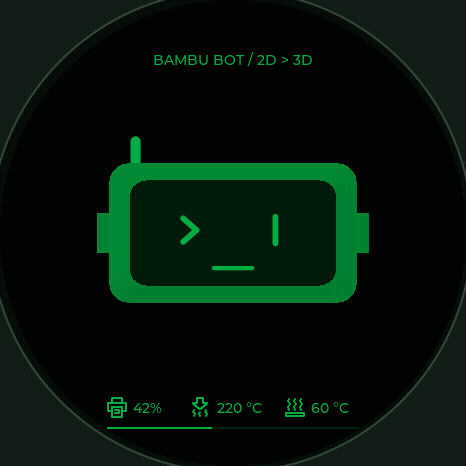
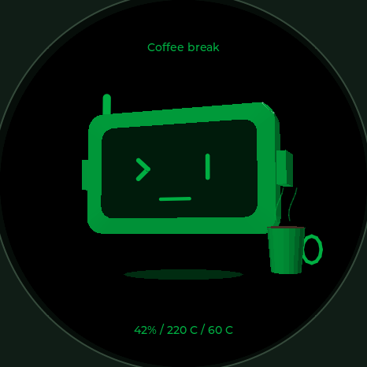
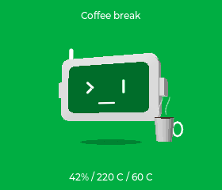
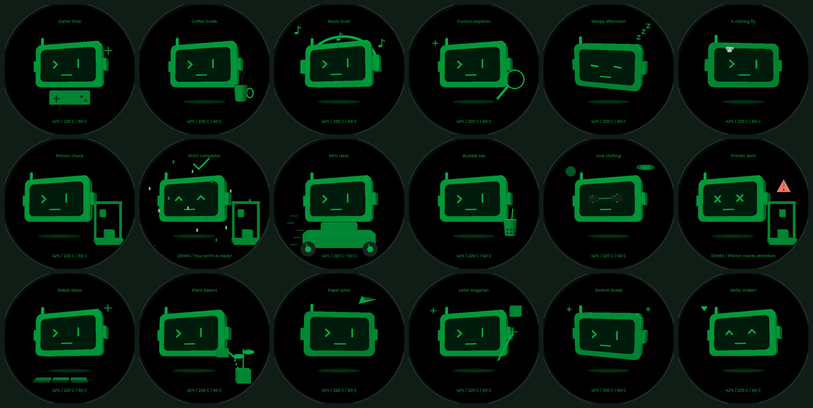

# Bambu Bot — 3D idle stories

Bản thử nghiệm **Emotion Studio 0.3.1**, triển khai trước trên simulator macOS. Bấm **3D scenes** hoặc **D** để chuyển từ bộ 14 emotion 2D sang bộ 18 hoạt cảnh 3D. Chọn một cảnh để chạy phần mở đầu: mặt phẳng dần có độ dày, đầu robot lớn hơn được đặt giữa màn hình và đạo cụ xuất hiện trong **1,2 giây**, sau đó bot bắt đầu hoạt động.

Từ **0.3.1**, robot chỉ có **phần đầu**; đã bỏ toàn bộ thân, tay, bàn tay, chân và bàn chân. Đầu được phóng lớn, đặt lại gần giữa màn hình; đạo cụ vẫn chuyển động độc lập quanh đầu.

Đây là nhân vật 3D phong cách low-poly: các đỉnh tọa độ XYZ được xoay, chiếu phối cảnh, tô sáng và kiểm tra độ sâu từng pixel bằng CPU. Khung hình được đưa vào LVGL như một ảnh động sinh tại runtime; không dùng video/GIF có sẵn, OpenGL hoặc dịch vụ AI. Các đường cong/đạo cụ là hình học đơn giản để thử hướng mỹ thuật và chuyển động trước.

| Màn tròn 466×466 | Desk-bot 280×240 |
| --- | --- |
|  |  |

## Điều khiển

| Thao tác | Kết quả |
| --- | --- |
| 3D scenes / 2D moods hoặc D | Chuyển bộ hoạt cảnh và bộ emotion cũ |
| Chọn một trong 18 cảnh | Phát lại phần chuyển 2D → 3D rồi diễn cảnh |
| B | Phát lại phần chuyển 2D → 3D của cảnh đang chọn |
| Play sequence / Space | Duyệt cảnh tự động, mỗi 9 giây; chế độ 2D vẫn 3,5 giây |
| Motion on/off / M | Dừng/tiếp tục chuyển động tại thời điểm hiện tại |
| Black / Green; Green / White; T | Chuyển theme, giữ cảnh và thời điểm |
| Round / Desk-bot; R | Đổi 466×466 / 280×240, giữ cảnh và thời điểm |
| Phím trái/phải | Cảnh trước/sau trong bộ đang mở |

Phần nền và nét chính dùng Bambu Green `#00AE42`, đen hoặc trắng theo theme; mô hình 3D thêm các mức sáng/tối để thấy bề dày và hướng mặt. Dấu cảnh báo đỏ dùng riêng trong cảnh lỗi. Các cảnh âm nhạc/game/xe chỉ minh họa bằng hình, chưa có âm thanh.

## Kịch bản

Các chuyển động diễn ra sau phần mở đầu chung. Bot luôn giữ đầu bo góc, anten trái, mắt dấu `>` và mắt thanh dọc; một số cảnh đổi mắt để thể hiện hành động.

| Cảnh trong Studio | Diễn biến |
| --- | --- |
| Game time | Tay cầm game lơ lửng dưới đầu → nhịp nút bấm thay đổi → bot lắc nhẹ, biểu tượng game lơ lửng. |
| Coffee break | Cốc có quai lơ lửng cạnh đầu → cốc nhích lên để nhấp → hạ cốc; các vệt hơi uốn nhẹ phía trên. |
| Music lover | Đeo tai nghe → gật đầu theo nhịp → các nốt nhạc trôi lên. |
| Curious explorer | Nghiêng đầu → đưa kính lúp quét trước mặt → điểm sáng gợi một phát hiện mới. |
| Sleepy afternoon | Mắt khép → đầu cúi dần → nhích tỉnh rồi lại gật; chữ z trôi lên. |
| A visiting fly | Ruồi bay vòng số 8 → bot quay đầu theo → cánh ruồi rung và có dấu đường bay. |
| Printer check | Bot đứng cạnh máy in thu nhỏ → đầu in di chuyển ngang → khối in nhô lên theo chu kỳ minh họa. |
| Print complete! | Mắt cười → đầu nhảy nhẹ → dấu hoàn tất và confetti rơi cạnh máy in. |
| Mini racer | Đầu bot nhô lên trên xe nhỏ → vạch tốc độ lướt qua → dấu trên bánh quay liên tục. |
| Bubble tea | Ly có trân châu và ống hút lơ lửng cạnh đầu → nâng ly → hạ ly, lắc đầu thỏa mãn. |
| Just chilling | Đeo kính râm → đung đưa chậm → mây trôi dưới nắng nhỏ. |
| Printer alert | Máy in dừng đầu phun → dấu chấm than đỏ xuất hiện → bot có mắt X và nhìn về phía máy. |
| Robot disco — bổ sung | Nhún và nghiêng đầu theo nhịp → các ô sàn đổi độ sáng. |
| Plant parent — bổ sung | Bình tưới nghiêng về phía chậu → ba giọt nước rơi → mầm cây có hai lá. |
| Paper pilot — bổ sung | Máy bay giấy lượn theo quỹ đạo → bot quay đầu theo → gật đầu chào máy bay. |
| Little magician — bổ sung | Đũa phép lơ lửng → tia sao ở đầu đũa → khối lập phương nhấp nhô trên không. |
| Stretch break — bổ sung | Nghiêng đầu sang hai phía → ngẩng/cúi chậm → trở về giữa. |
| Hello, maker! — bổ sung | Mắt cười → gật đầu chào → trái tim nhỏ bên cạnh khuôn mặt. |

## Phạm vi bản thử nghiệm

Cảnh hoàn tất và lỗi được chọn bằng tay trong simulator; chưa phải phản ứng với máy in thật. Bộ này **chưa được đưa vào firmware v0.2.0**. Giao diện 2D đã tích hợp trên firmware vẫn giữ nguyên.

Bản 3D dùng hai buffer màu/độ sâu cùng kích thước LCD: khoảng 1,66 MiB ở 466×466 hoặc 525 KiB ở 280×240, cộng bộ nhớ hình học, LVGL và SDL. Vì vậy chưa thể coi đây là ngân sách RAM/FPS đã đạt trên ESP32; bước tiếp theo cần đo trên thiết bị, giảm độ phân giải render hoặc rút gọn mô hình. Shader ánh sáng đơn giản, không có phản xạ vật lý; kính lúp/ly chỉ minh họa, không khúc xạ thật.

Renderer ở `simulator/scene3d.h` và `simulator/scene3d.cc`. Chỉ biên dịch cùng target simulator; không sửa pin, LCD driver hoặc luồng dữ liệu firmware. Pool hình học cố định 3.072 primitive, buffer được cấp phát khi tạo view và tái sử dụng qua các frame. Phần hiển thị 3D có hai label LVGL cố định, không tạo/xóa widget theo frame.

## Kiểm tra và xuất ảnh

Chạy build/CTest như [UI_STUDIO.md](UI_STUDIO.md). Smoke test đi qua click SDL/LVGL của mode 3D và cả 18 nút cảnh, hai theme và hai màn hình; kiểm tra các mốc 0 / 600 / 1.200 / 2.500 / 5.000 / 9.000 / 17.000 ms, không tràn pool hình học, không tăng số widget và có thể trở lại 2D. Kiểm tra tạm dừng/tiếp tục và giữ thời điểm khi đổi display. Bài kiểm tra cũ của emotion, input, thông báo, offline/stale vẫn chạy.

Lệnh `--headless --output dist/ui-preview` xuất thêm 72 ảnh cảnh LCD (`scene-<index>-<display>-<theme>.bmp`), ảnh `studio-3d.bmp` và 80 frame của cảnh cà phê trong thư mục `animation/`. GIF trong tài liệu được ghép từ các frame render đó; không phải tài sản dùng để chạy UI.
