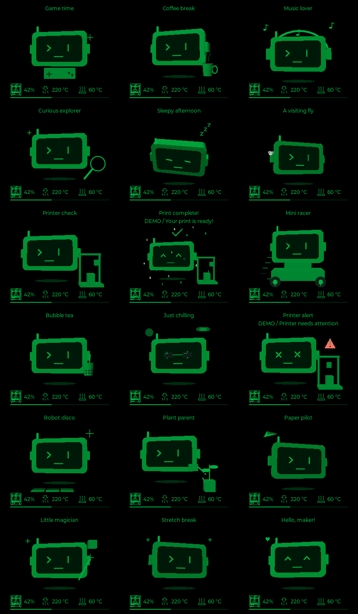
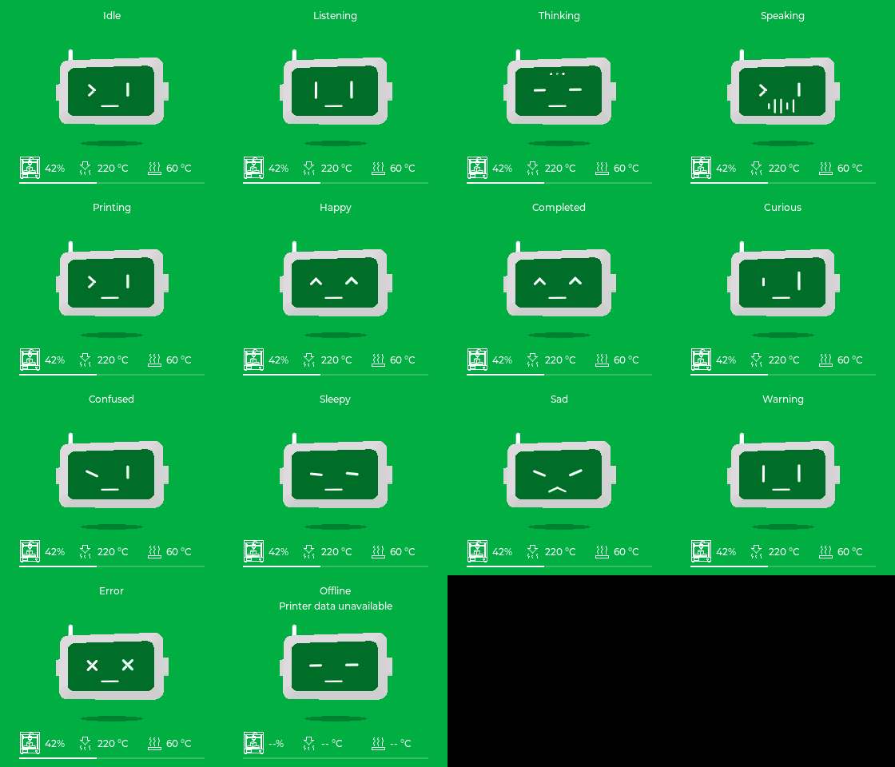

# Bộ animation 0.4.0 — 18 kịch bản và 14 biểu cảm 3D


LCD **280×240** phát frame 3D dựng sẵn ở nhịp mục tiêu **20 FPS**, gồm đủ hai theme
đen/xanh Bambu `#00AE42` và xanh Bambu/trắng. Nhiệt đầu phun, bàn nhiệt, phần trăm,
icon và thông báo là lớp LVGL riêng. Không lưu số liệu máy in vào animation.
Robot chỉ có phần đầu; xe, máy in, cốc và các đạo cụ là vật thể minh họa độc lập.

## Xem trên macOS

```sh
./scripts/run_simulator.sh --all-demo
./scripts/run_simulator.sh --heads-demo
```

Trong Studio **0.4.0**:

- **Desk-bot 280×240 → 3D scenes** hoặc **D**: chọn 18 kịch bản.
- **3D heads** hoặc **E**: chọn 14 biểu cảm đầu robot, không kèm đạo cụ.
- **T** đổi theme, **M** dừng/tiếp tục, **B** phát lại mở đầu, trái/phải chọn mục.
- **Space / Play sequence** duyệt tự động; **R** chuyển loại màn hình.
- Màn tròn **466×466** tiếp tục dùng bộ dựng hình học trên CPU của Mac.

### 18 kịch bản

Game time · Coffee break · Music lover · Curious explorer · Sleepy afternoon ·
A visiting fly · Printer check · Print complete! · Mini racer · Bubble tea ·
Just chilling · Printer alert · Robot disco · Plant parent · Paper pilot ·
Little magician · Stretch break · Hello, maker!



[18 kịch bản — xanh/trắng](ui/all-scenes-green.png)

### 14 biểu cảm phần đầu

Idle · Listening · Thinking · Speaking · Printing · Happy · Completed · Curious ·
Confused · Sleepy · Sad · Warning · Error · Offline.



[14 biểu cảm — đen/xanh](ui/all-heads-black.png)

Speaking là waveform minh họa dựng sẵn, chưa đồng bộ biên độ âm thanh TTS.

## Bộ nhớ và cách phát

| Thành phần | Dung lượng / hành vi |
| --- | --- |
| Bank `animations.bba` | **3.602.446 byte (~3,44 MiB)**, trong phân vùng assets có sẵn |
| Nội dung | 32 clip × 2 theme, **5.756 tham chiếu frame**, 2.614 frame nén dùng chung hai theme |
| Hai buffer RGB565 dùng chung | **136.160 byte (~133 KiB)** sau khi cả hai được sử dụng; không tăng theo số cảnh |
| Scratch giải mã palette | **34.886 byte (~34 KiB)** dùng lại giữa các frame, ngoài hai buffer RGB565 |
| Bộ giải nén ESP32-S3 | `tinfl_decompress` trong ROM, một state tái sử dụng trên heap/PSRAM; không đặt inflater lớn trên stack LVGL |
| SPI LCD | Hai buffer DMA 280×20 RGB565; giữ pinout và driver ST7789 |
| Build custom wake word + MN7 English | App **0x354250 byte**, còn **15%** slot ứng dụng; assets **7.284.197 byte**, còn **1.104.411 byte** phân vùng 8 MiB |

Bank được memory-map từ flash, không chép toàn bộ vào PSRAM. Hai buffer màu/depth
và pool hình học của renderer dự phòng vẫn tồn tại, ngoài bộ đệm phát animation.
Không thay bảng phân vùng, NVS hoặc hai slot OTA. Mã và asset không chứa cấu hình
LAN cá nhân trong bản demo công khai.

Mỗi clip có 24 frame mở đầu, dài 1,2 giây. Coffee có vòng lặp 126 frame (6,3 giây);
các clip khác có 64 frame (3,2 giây). Source animation dùng chung chu kỳ hình học
để khớp vòng lặp. Bank v3 lưu bảng màu RGB565 cho cả hai theme và một luồng chỉ số chung, nén zlib
độc lập từng frame. Đây là nén **không mất dữ liệu**: giữ nguyên từng pixel, crop,
số frame và thời lượng của bank v2. Decoder vẫn đọc được bank v2. Khi phát,
giải nén vào scratch dùng lại rồi tra bảng màu vào buffer RGB565; bỏ frame trễ theo thời gian
thay vì tạo hàng đợi. Chỉ ghi vào buffer không đang hiển thị.

Vùng hình học được tính một lần cho cả clip và hai theme. Nếu cần, toàn bộ vùng
được thu nhỏ/đặt lại đồng nhất để vừa giữa tiêu đề và HUD (y=44…195), tránh crop
nhảy từng frame. Crop và mức fit từng clip nằm trong manifest. Mỗi frame chỉ
invalidate vùng ảnh; chữ/icon không đổi không được ghi lại.

## Chọn cảnh trong firmware bình thường

- 15 cảnh vui luân phiên khi idle, mỗi 12 giây; không tự chèn lỗi/hoàn tất.
- RUNNING/PREPARE dùng Printer check; FINISH có xác nhận dùng cảnh hoàn tất;
  lỗi có dữ liệu xác nhận dùng Printer alert.
- PAUSE/Warning chuyển sang đầu cảnh báo, không phát máy in đang chuyển động.
- Listening/Thinking/Speaking và biểu cảm AI dùng clip phần đầu, không kèm đạo cụ.
- Biểu cảm AI Error/Completed dùng đầu tương ứng; không tạo lỗi/hoàn tất máy in giả.
- Khi ngủ, giữ cơ chế dừng animation hiện tại.

Thiếu, sai định dạng hoặc giải nén lỗi thì quay về renderer CPU, không giữ frame
cảnh cũ làm trạng thái hiện tại. Khi tải lại assets, bank được tháo dưới khóa
hiển thị trước khi unmap flash, rồi nạp lại sau khi tải thành công. Nếu gói assets
mới không có bank, renderer dự phòng vẫn hoạt động.

## Build demo duyệt toàn bộ

```sh
. "$IDF_PATH/export.sh"
idf.py -B build-all-demo -D BAMBU_FORCE_DEMO=ON -D BAMBU_ANIMATION_PREVIEW=ON -D BAMBU_COFFEE_PREVIEW=OFF -D BAMBU_PRINTER_PREVIEW=OFF build
python3 scripts/package_demo.py --build-dir build-all-demo
```

Profile demo duyệt 18 cảnh rồi 14 biểu cảm, mỗi mục khoảng 7,5 giây khi trợ lý rảnh
và nguồn demo đang cho phép. Đàm thoại, ngủ và các trạng thái ưu tiên vẫn can thiệp.
Cảnh Complete/Error trong preview có chú thích DEMO. Đây là hình minh họa, không
điều khiển máy in. Profile này yêu cầu `BAMBU_FORCE_DEMO=ON` để không trộn cảnh lỗi
minh họa vào dữ liệu LAN thật.

Firmware bình thường để `BAMBU_ANIMATION_PREVIEW=OFF`. Cấu hình LAN riêng vẫn dùng
header cục bộ bị Git bỏ qua. Không chia sẻ binary build riêng. Khi nâng cấp từ bản
cũ phải nạp cả **generated_assets.bin** theo FLASHING.txt; app OTA riêng thiếu bank
sẽ chỉ chạy renderer dự phòng.

## Tạo lại dữ liệu và kiểm tra

```sh
./scripts/run_simulator.sh --export-animations /tmp/bambu-all-animation-sources
python3 scripts/generate_animation_bank.py /tmp/bambu-all-animation-sources
./scripts/run_simulator.sh --animations-preview dist/animations-preview
ctest --test-dir simulator/build --output-on-failure
python3 scripts/verify_animation_assets.py build-all-demo/generated_assets.bin
```

Bước generate offline cần NumPy; firmware không cần Python/NumPy. Exporter dùng
chính hình học của simulator, không thu HUD, mạng, mic hay cấu hình máy in.
Manifest: [animation_bank.json](../ui/assets/animation_bank.json).
`SceneView::EnableAllPlayback(false)` chọn renderer mesh để so sánh hoặc xuất source.
Hai clip PackBits cũ giữ trong source để tái tạo/kiểm tra bản thử trước; chúng không
còn được link vào firmware 0.4.0. Bộ mới dùng palette RGB565 hai theme/zlib trong assets.

Kiểm thử Release và ASan/UBSan bao phủ tất cả 5.756 frame, dữ liệu lỗi/cắt cụt,
vòng lặp, 32 clip ở hai theme, đổi cảnh nhiều lần với RAM/widget có giới hạn,
HUD live/stale/offline, ưu tiên sự kiện máy in, tải lại bank, fallback và khôi phục,
click nhanh vào 14 nút 3D heads, hai kích thước màn hình. Gói build được kiểm tra
checksum assets và SHA-256 của bank trước khi đóng ZIP.

**20 FPS là nhịp mục tiêu, chưa phải số đo trên LCD thật.** Bản 0.4.0 chưa nạp vào
Desk-bot; chưa đo FPS, heap và tác động đồng thời của âm thanh/Wi-Fi/MQTT trên thiết bị.

## Khi thấy `Animation bank: 0 bytes`

Đây là renderer CPU dự phòng (nhịp mục tiêu 100 ms/10 FPS), chưa phải phát bank.
App 0.4.0 có thể được nạp cùng assets cũ nếu chỉ chạy `idf.py flash` với build cũ:
trước bản sửa dependency, target `flash` không kéo theo target tạo default assets.
Log nạp 1.200.796 byte assets là gói cũ không có bank, dù flash thành công.

Target flash hiện phụ thuộc vào tạo assets và kiểm tra checksum/SHA-256 bank trước
khi gọi esptool. `idf.py flash monitor` sẽ dựng lại assets nếu cần. Log đúng phải
có `Animation bank: 5533517 bytes`. Chạy kiểm tra trước khi nạp nếu cần:

```sh
python3 scripts/verify_animation_assets.py build/generated_assets.bin
```

Các file `._*.png` trên volume macOS cũng đã được lọc khỏi index emoji; đó là
metadata AppleDouble, không phải ảnh emotion và không phải số đo FPS.


## Custom wake word và MultiNet

Với Desk-bot ESP32-S3 / 8 MiB PSRAM, ưu tiên **MN7 English** khi dùng custom wake
word theo tiếng Anh. MN5 Q8 giảm RAM nhưng chất lượng nhận dạng thấp hơn; MN6
không phải lựa chọn tiết kiệm hơn MN7 trong benchmark Espressif:

| Model | Internal RAM | PSRAM | Thời gian / frame âm thanh 32 ms |
| --- | --- | --- | --- |
| MN5 Q8 | 16 KB | 2.310 KB | 12 ms |
| MN6 | 32 KB | 4.100 KB | 12 ms |
| MN7 | 18 KB | 2.920 KB | 11 ms |

[Nguồn benchmark Espressif](https://docs.espressif.com/projects/esp-sr/en/latest/esp32s3/benchmark/README.html).
Đây là số tham khảo của hãng, không phải phép đo trên Desk-bot. PSRAM trong bảng
là bộ nhớ khi chạy, **khác** dung lượng model trong flash. MultiNet nhận lệnh
English/Chinese; không phải model tiếng Việt. Cụm “bam bu” cần thử nhận dạng thực
tế, đặc biệt khi máy in/quạt chạy. AI đàm thoại tiếng Việt dùng dịch vụ riêng.

Bank cũ 5.533.517 byte cộng model MN7 và font tạo assets 9.215.268 byte, vượt
phân vùng 8 MiB 826.660 byte. Bank v3 giảm 1.931.071 byte mà giữ toàn bộ cảnh,
hai theme và nhịp mục tiêu 20 FPS. Build MN7 sau tối ưu: assets **7.284.197 byte**,
còn **1.104.411 byte**. Không cần tắt MN7, xoá cảnh hoặc đổi partition.
Phải nạp **app và generated_assets.bin cùng bản** để app có decoder v3.
Chưa có phép đo FPS LCD khi chạy đồng thời MN7; cần kiểm tra sau khi nạp.

Định dạng bank v3: header `BBANIM03`, version 3, trường cuối header là số màu
palette tối đa (hiện 211). Mỗi frame giải nén thành `uint16_le color_count`,
`color_count` cặp RGB565 little-endian (đen trước, xanh sau), rồi chỉ số pixel
8 bit nếu ≤256 màu, 16 bit nếu nhiều hơn. Frame table của hai theme trỏ chung
payload. Không có phụ thuộc frame trước, nên bỏ frame trễ/seek vẫn độc lập.
Parser giới hạn palette ≤1024 màu, kiểm tra kích thước và từng chỉ số trước khi dùng.
