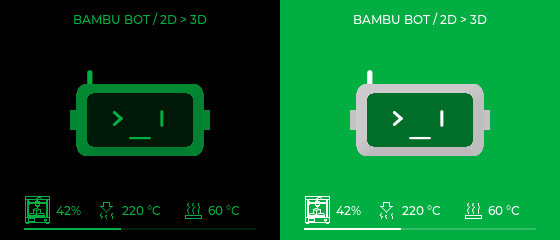

# Coffee animation experiment — Desk-bot 280×240



The coffee scene now plays pre-rendered geometry at a **50 ms target (20 FPS)** on
280×240. It bypasses CPU mesh construction, lighting, depth testing and scaling.
The 466×466 simulator and other scenes keep the existing CPU renderer.

There are 24 introductory frames (1.2 s, 2D → 3D), followed by a seamless
126-frame loop (6.3 s). Head yaw, cup movement and steam share the same period.
The renderer generates geometry only; printer values, icons, title and messages
remain independent native LVGL objects. Both black/green and green/white themes
are included. Listening, speech, sleep and printer alerts interrupt playback.

## Try on macOS

```sh
./scripts/run_simulator.sh --coffee-demo
```

Or open the packaged Studio, select **Desk-bot 280×240 → 3D scenes → Coffee break**.
`T` changes theme, `M` pauses/resumes, `B` replays the intro.

The same decoder and assets run in the simulator and firmware. To compare with
live mesh rendering in code, call `SceneView::EnableCoffeePlayback(false)`.

## Storage and transfer

- Cropped rectangle: **167×129**, at **(67,56)**; no full-screen frame transfer.
- 300 stored frames (150 per theme), RGB565 palettes with PackBits indices.
- Flash data including palettes and frame offsets: **683,154 bytes (~667 KiB)**.
- The first Coffee-only version used **86,172 bytes (~84 KiB)** for its two decoded buffers.
  Since Studio 0.3.5, Coffee shares buffers with Printer check: **112,000 bytes (~109 KiB)**
  reserved for the larger clip after both buffers are used.
  The other scenes' existing mesh/raster buffers remain allocated.
- ESP32 configuration routes large allocations to PSRAM. LCD uses two internal
  280×20 RGB565 DMA buffers; enabling the second adds **11,200 bytes internal RAM**.
- Frame selection follows elapsed time and skips overdue frames instead of
  accumulating a queue. Only the image rectangle is invalidated during playback;
  unchanged labels are not rewritten. No widget creation per frame.
- The compressed data is memory-mapped from flash; no filesystem/network fetch
  or bitmap-image decoder is required. PackBits writes directly into RGB565.

Palette fitting preserves common flat colors and covers rare highlights; the
largest source-to-palette channel error is approximately 8.23/255, after RGB565 sampling. Asset dimensions/budgets are recorded in
[coffee_clip.json](../ui/assets/coffee_clip.json).

## Recreate assets and previews

```sh
./scripts/run_simulator.sh --export-coffee /tmp/bambu-coffee-frames
python3 scripts/generate_coffee_clip.py /tmp/bambu-coffee-frames
./scripts/run_simulator.sh --coffee-preview dist/coffee-preview
ctest --test-dir simulator/build --output-on-failure
```

Generation uses SDL/LVGL and Python's standard library. The generated `.inc`
contains only geometry, never printer configuration, labels or telemetry.

## Firmware profiles

Normal firmware automatically uses this clip when the idle rotation reaches
Coffee. To keep Coffee visible for comparison while the assistant is idle, use
the explicit experimental profile below. It replaces the ordinary idle/printing
visuals while retaining the HUD and all higher-priority states. This public
build deliberately uses simulated printer telemetry:

```sh
. /Users/dangminhtam/esp/esp-idf/export.sh
idf.py -B build-coffee-demo -D BAMBU_FORCE_DEMO=ON -D BAMBU_COFFEE_PREVIEW=ON build
python3 scripts/package_demo.py --build-dir build-coffee-demo
```

`BAMBU_FORCE_DEMO` defaults OFF and excludes `local_config.h` when enabled. The
packager checks the CMake setting and a marker in the compiled demo binary.
Private LAN configuration and the existing private `build/` stay separate.
For a private LAN experiment, use a separate build directory and omit
`BAMBU_FORCE_DEMO`; never publish that binary.

## Validation and limits

Release and ASan/UBSan simulator tests cover all 300 frames, malformed/truncated
RLE data, frame boundaries/loop timing, two themes, bounded buffers/widgets,
live and stale telemetry, pause/replay and conversation/error interruption.
The firmware compiles for ESP32-S3 and fits the existing app partition.

**20 FPS is a scheduling target, not a measured physical-LCD result.** This
iteration has not been flashed or profiled on the Desk-bot. Measure LCD refresh,
free internal/PSRAM and voice/MQTT behavior together before increasing frame rate
or converting all 18 scenes. Simulator speed does not establish ESP32 performance.
