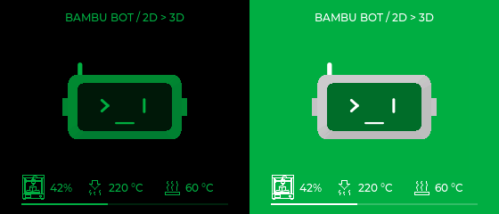

# Printer check — pre-rendered 3D playback experiment



The 280×240 **Printer check** scene now uses the same RGB565/PackBits playback
path as Coffee. The head floats beside a small printer: its nozzle moves across
the gantry while the example print changes height. This is an illustrative
animation; the HUD independently displays actual or simulated printer telemetry.
It does not send motion or print commands to the printer.

Both themes are supported: black/Bambu Green and Bambu Green/white.
The 1.2 s introductory morph has 24 frames, then 64 frames loop over 3.2 s.
The target is 20 FPS. Head yaw, floating motion, nozzle and print share a common
loop period, avoiding a jump at the loop boundary.

## Try in the simulator

```sh
./scripts/run_simulator.sh --printer-demo
```

Or open Studio 0.3.5, choose **Desk-bot 280×240 → 3D scenes → Printer check**.
`T` changes theme, `M` pauses/resumes, `B` replays the intro.
The round 466×466 preview keeps the live mesh renderer.

## Budget

- Geometry crop: **200×140**, at **(46,56)**; labels and HUD stay separate.
- **176 frames total** across two themes; native RGB565 palette plus PackBits.
- New flash data: **423,255 bytes (~413 KiB)**, including palette and offsets.
- Two buffers shared with Coffee: **112,000 bytes (~109 KiB)** reserved after
  both buffers are used. The first Coffee experiment alone used 86,172 bytes;
  this version reserves for the larger Printer clip to avoid allocation growth
  while switching scenes. Existing mesh/raster memory remains allocated.
- Both clips together use **1,106,409 bytes** of flash data. The shorter Printer
  loop keeps the combined firmware within the existing app partition.
- LCD retains two 280×20 RGB565 DMA buffers. Frame changes invalidate only the
  clip rectangle. The same bounds-checked decoder is used by both scenes.

Normal firmware uses the clip for the Printer scene with Idle/Printing
expressions. Paused/warning, error, completion, listening, speaking, sleep and
offline expressions use the appropriate existing visual instead. Normal scene
selection still requires printer-state evidence for printer events. The explicit
preview profile below lets the user inspect the scene while the assistant is
idle, without waiting for a printing state; alerts and conversations take priority.

## Demo firmware build

```sh
. "$IDF_PATH/export.sh"
idf.py -B build-printer-demo -D BAMBU_FORCE_DEMO=ON -D BAMBU_PRINTER_PREVIEW=ON -D BAMBU_COFFEE_PREVIEW=OFF build
python3 scripts/package_demo.py --build-dir build-printer-demo
```

This public demo uses simulated printer telemetry. Its build directory is
separate from private LAN firmware. Both preview options cannot be enabled
simultaneously. Leave `BAMBU_PRINTER_PREVIEW` OFF for ordinary automatic selection.

## Recreate geometry and preview

```sh
./scripts/run_simulator.sh --export-printer /tmp/bambu-printer-frames
python3 scripts/generate_coffee_clip.py /tmp/bambu-printer-frames --scene printer
./scripts/run_simulator.sh --printer-preview dist/printer-preview
```

The generator reuses the Coffee codec and palette fitter. The captured frames
contain geometry only, not HUD values, messages or private configuration.
Manifest: [printer_clip.json](../ui/assets/printer_clip.json).
`SceneView::EnablePrinterPlayback(false)` selects the mesh for comparison.

## Verification limits

Host tests cover all 176 Printer frames, invalid frame/size inputs, loop timing,
20 repeated Coffee/Printer transitions with a bounded shared allocation, both
themes, live/stale HUD values, priority expressions, pause/replay and the round
screen fallback. Existing Coffee and input/scene tests remain enabled, including
ASan/UBSan. Firmware is compiled for ESP32-S3: app **0x3c83d0 bytes**, with
**0x27c30 bytes (4%)** remaining in the existing app partition.

This iteration is **not flashed to Desk-bot**. Its 20 FPS target has not been
measured on the physical LCD, including simultaneous audio/Wi-Fi/MQTT. Only a
hardware run can establish the actual refresh rate and available heap.
