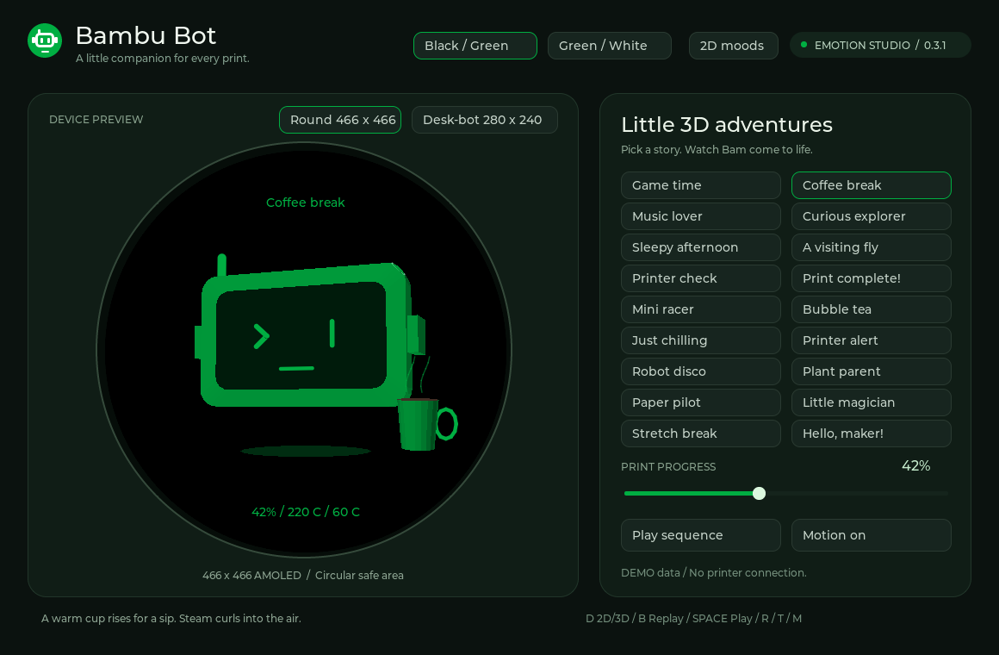
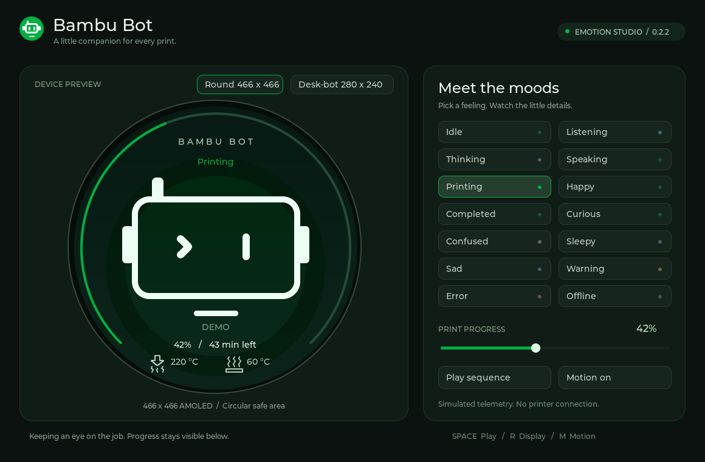
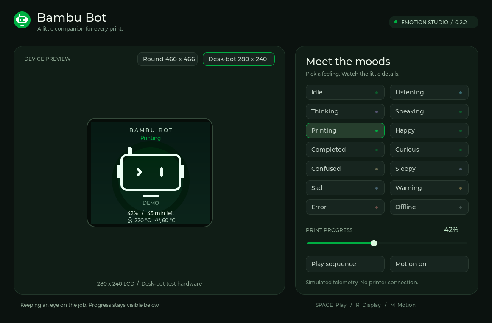
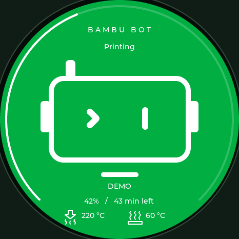
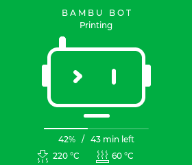

# Bambu Bot Emotion Studio

Ứng dụng giả lập **LVGL 9.5.0 + SDL2 trên macOS**, dùng để duyệt khuôn mặt và emotion trước khi tích hợp vào firmware. Đây là giao diện LVGL thực sự, không phải mockup web hoặc ảnh GIF.


## 3D idle stories — thử nghiệm 0.3.3

Bấm **3D scenes** ở thanh trên hoặc phím **D** để mở 18 hoạt cảnh low-poly **chỉ phần đầu robot** với intro 2D → 3D. Phím **B** phát lại intro; **Space** duyệt tự động. Có chơi game, cà phê, âm nhạc, tìm tòi, ngủ gật, ruồi, kiểm tra máy in, hoàn tất/lỗi, đua xe, trà sữa, chill và sáu cảnh bổ sung. Xem [bộ kịch bản và giới hạn 3D](3D_SCENES.md). Từ firmware **v0.3.0**, renderer này cũng chạy trong Desk-bot với cấu hình giảm độ phân giải, xem [tích hợp firmware](3D_SCENES.md#phạm-vi-bản-thử-nghiệm).



## Thiết kế

Lấy cảm hứng từ biểu tượng robot xanh/trắng trong ảnh `IMG_6476.PNG`: đầu chữ nhật bo góc, hai tai, anten bên trái, mắt trái hình dấu `>` và mắt phải hình viên thuốc. Hai theme dùng nền phẳng: **đen `#000000` / nét xanh Bambu `#00AE42`**, hoặc **xanh Bambu `#00AE42` / nét trắng `#FFFFFF`**. Robot, icon, chữ và các chi tiết emotion tuân theo màu của theme; hình dạng và chuyển động phân biệt cảm xúc. Chuyển động nhỏ để robot có sức sống mà không làm mất khả năng đọc thông tin máy in.

Vẽ bằng `lv_obj`, `lv_line`, `lv_arc`, `lv_bar` và `lv_label`; không cần bitmap, GIF, SVG hay ThorVG. Các mảng điểm vẽ sống cùng component để an toàn với API `lv_line_set_points`. Animation dùng một timer 33 ms và tập đối tượng cố định, không tạo/xóa đối tượng ở mỗi frame.

Màu xanh chính là **Bambu Green `#00AE42` — RGB `(0, 174, 66)`**, đối chiếu trực tiếp từ [logo Bambu Studio chính thức](https://github.com/bambulab/BambuStudio/blob/master/resources/images/splash_logo.svg). Màu này dùng làm nét trên nền đen hoặc nền của theme xanh. Dấu màu phân loại emotion chỉ nằm ở bảng điều khiển Studio.

Từ **0.2.2**, dòng nhiệt độ dùng icon đầu phun và bàn nhiệt thay chữ Nozzle/Bed, kèm giá trị `°C`. Hình vẽ LVGL độc lập theo hình thái của [nozzle](https://github.com/bambulab/BambuStudio/blob/master/resources/images/monitor_nozzle_temp.svg) và [bed](https://github.com/bambulab/BambuStudio/blob/master/resources/images/monitor_bed_temp.svg) trong Bambu Studio: đầu phun hướng xuống, bàn nhiệt có ba vệt nhiệt. Không nhập SVG hoặc mã nguồn Bambu Studio. Mất dữ liệu dùng `-- °C`; offline/stale ẩn dòng nhiệt độ, và thông điệp kích hoạt tạm thay thế dòng này.

## Chạy trên macOS

```sh
brew install cmake ninja sdl2
./scripts/run_simulator.sh
```

Script build chế độ Release và mở ứng dụng. Nếu đã có bản đóng gói, chỉ cần mở `dist/Bambu Bot Studio.app`; SDL2 đã được kèm bên trong bản đóng gói nên không cần Homebrew để chạy bản đó.

Ứng dụng được build/kiểm tra trên Mac Apple Silicon **arm64** trong môi trường hiện tại; bản ZIP này có deployment target **macOS 26.0**. Chưa kiểm chứng Intel hoặc các phiên bản macOS khác. Bản đóng gói ký ad-hoc để chạy thử, chưa notarize.

Nếu chưa build firmware và chưa có `managed_components/lvgl__lvgl`, CMake tự tải LVGL tag `v9.5.0`. Có thể chỉ định nguồn sẵn có bằng `-DBAMBU_LVGL_DIR=/absolute/path/to/lvgl`. LVGL source phải đúng 9.5.0.

## Điều khiển

Bản **0.2.1** sửa lỗi bỏ qua click nhanh khi cặp nhấn/thả chuột nằm trong cùng lượt xử lý SDL. Nếu đang mở bản cũ, thoát cửa sổ cũ rồi mở lại bản **0.3.3**; phiên bản hiện trên tiêu đề cửa sổ và góc trên bên phải.

| Thao tác | Kết quả |
| --- | --- |
| Chọn một emotion bên phải | Đổi mắt, miệng và chuyển động; giữ theme đang chọn |
| Black / Green hoặc Green / White; phím T | Chuyển theme, giữ emotion, tiến độ và motion |
| Round / Desk-bot | Đổi vùng render thật 466×466 hoặc 280×240 |
| Thanh Print progress | Đổi dữ liệu giả lập từ 0–100% |
| Play sequence / Space | Chạy lần lượt các emotion, mỗi 3,5 giây |
| Motion on/off / M | Bật/tắt chuyển động khuôn mặt |
| R | Đổi loại màn hình |
| Phím trái/phải | Chuyển emotion trước/sau |
| Escape | Đóng ứng dụng |

Số liệu đều là giả lập; bảng điều khiển ghi **DEMO data / No printer connection**. Màn 280×240 đã bỏ nhãn DEMO, nâng khuôn mặt và giãn các hàng tiến độ/nhiệt độ; màn tròn vẫn có nhãn nguồn. Simulator không kết nối A1, không thu âm và không gọi server AI. Waveform của trạng thái Speaking là animation minh họa, chưa đồng bộ biên độ TTS.









## Bộ emotion

| Emotion | Biểu cảm/chuyển động |
| --- | --- |
| Idle | Mắt bất đối xứng của biểu tượng gốc; thở và chớp mắt |
| Listening | Mở mắt cao hơn, nhịp lắng nghe nhẹ |
| Thinking | Liếc nhẹ; ba chấm chuyển động trên đầu |
| Speaking | Năm thanh sóng thay cho miệng |
| Printing | Giữ khuôn mặt quen thuộc và tiến độ in |
| Happy | Mắt cười, miệng cong, nhún nhẹ |
| Completed | Mắt cười và các hạt trang trí ăn mừng; demo chuyển tiến độ lên 100% |
| Curious | Hai mắt cao thấp khác nhau, liếc nhẹ |
| Confused | Một mắt nghiêng, miệng hơi lệch |
| Sleepy | Mắt khép, nhịp thở chậm và chữ z |
| Sad | Mắt trĩu, miệng buồn, một giọt nước mắt |
| Warning | Mắt dựng, trạng thái Warning rõ ràng |
| Error | Mắt chữ X; không nhấp nháy cảnh báo |
| Offline | Mắt ngang, nét mờ và thông báo mất kết nối; ẩn số liệu sống |

Emotion có chuyển hình dạng mắt/miệng trong 280 ms. Khi chuyển liên tiếp, animation bắt đầu từ hình dạng hiện tại, tránh nhảy về tư thế ban đầu. Theme giữ nguyên khi emotion thay đổi. Trường thiếu dùng `--`; kết nối thiếu hoặc dữ liệu stale không hiển thị các số đo như dữ liệu hiện tại.

## Component dùng lại cho LCD

`ui/bambu_face.h` và `ui/bambu_face.cc` chỉ phụ thuộc LVGL. Constructor nhận parent, kích thước và kiểu màn hình:

```cpp
// Chỉ gọi trong LVGL thread hoặc khi đã giữ khóa LVGL.
bambu::ui::FaceView face(parent, 280, 240, false);
face.SetTheme(bambu::ui::Theme::Green); // Hoặc Theme::Black
face.SetEmotion(bambu::ui::Emotion::Listening);

bambu::ui::Telemetry status;
status.demo = true;
status.progress = 42;
status.remaining_min = 43;
status.nozzle_c = 220;
status.bed_c = 60;
face.SetTelemetry(status);
```

Component sở hữu root và timer; **hủy FaceView trước khi hủy parent/LVGL display**. Không copy/move component và không giữ nó trên stack của hàm đã trả về. `SetMessage` dành cho thông điệp ngắn, ví dụ mã kích hoạt; `SetMinimal` cho thumbnail biểu cảm; `FromXiaozhi` ánh xạ các tên emotion phổ biến của XiaoZhi và trả Idle khi tên chưa biết.

Firmware v0.2.0 dùng renderer 2D này; **v0.3.0** chuyển sang renderer 3D dùng chung `ui/scene3d.*` và icon mới trong `BambuDisplay` trên Desk-bot 280×240. Service chuyển snapshot đã lọc theo tuổi từng trường sang tiến độ/nhiệt độ; trạng thái hội thoại chọn Listening/Speaking/Thinking và trạng thái máy in chọn Printing/Completed/Warning/Error/Offline. Giữ nhấn BOOT để đổi theme và lưu NVS; MCP `light` → xanh/trắng, `dark` → đen/xanh. Thông báo Wi-Fi, kích hoạt và chat có lớp chữ dùng font đa ngôn ngữ của firmware; khi hết thông báo, UI trở lại số đo. Chưa kiểm chứng chạy thật hoặc đo RAM/FPS trên ESP32.

## Kiểm tra và xuất ảnh

```sh
cmake -S simulator -B simulator/build -G Ninja \
  -DCMAKE_BUILD_TYPE=RelWithDebInfo -DBAMBU_SANITIZERS=ON
cmake --build simulator/build --parallel 8
ctest --test-dir simulator/build --output-on-failure

# Xuất ảnh render LVGL thực; không cần mở cửa sổ.
simulator/build/bambu_studio.app/Contents/MacOS/bambu_studio \
  --headless --output dist/ui-preview
```

Headless export tạo ảnh toàn studio, bảng 14 emotion và ảnh LCD đúng kích thước. File BMP có thể đổi sang PNG bằng `sips` trên macOS. Các ảnh trong tài liệu được xuất từ chính renderer này.

Đã kiểm tra ngày 18/10/2026: build AppleClang trên nguồn LVGL có sẵn và bản tải sạch từ GitHub; bài smoke test ASan/UBSan cho toàn bộ nút emotion, chuyển màn hình, kích thước tập đối tượng ổn định, offline/stale/unknown, message, motion và alias; thử tương tác chuột/phím trực tiếp trên cửa sổ SDL2. Chưa đo FPS, RAM hay khả năng chạy trên ESP32.

Kiểm tra input của 0.2.1 đưa cặp SDL mouse-down/mouse-up vào cùng một lượt xử lý, đi qua input device LVGL để kiểm chứng hit testing của cả 14 nút emotion, hai nút display, Play/Motion và kéo slider. Bộ kiểm tra cũng xác nhận mất focus hủy lần nhấn và chuột phải không kích hoạt nút. Không gọi thẳng callback `LV_EVENT_CLICKED` để giả định click đã hoạt động.

Bản 0.2.3 bổ sung kiểm tra click hai nút theme trên cả hai loại màn hình, giữ theme khi đổi display/emotion, màu nền chính xác và ẩn DEMO trên Desk-bot. Các giá trị thiếu, offline và thông điệp vẫn được kiểm tra trong smoke test.

## Đóng gói ứng dụng

```sh
./scripts/run_simulator.sh --build-only
python3 scripts/package_studio.py
```

Script kèm SDL2 và thông báo giấy phép, đổi đường dẫn thư viện sang bundle, ký ad-hoc, kiểm tra chữ ký và chạy smoke test từ bản bundle. Nó từ chối đóng gói bản chứa sanitizer. Kết quả: `.app` và ZIP theo kiến trúc máy trong `dist/`. Việc ký được thực hiện ở thư mục tạm để tránh metadata AppleDouble của ổ ngoài đi vào bundle.

### Coffee playback experiment

Desk-bot 280×240 → 3D scenes → Coffee break now uses native-resolution,
pre-rendered RGB565 frames, with a 20 FPS scheduling target and independent
LVGL telemetry. Start directly with `./scripts/run_simulator.sh --coffee-demo`.
See [COFFEE_PLAYBACK.md](COFFEE_PLAYBACK.md) for memory costs, build profiles,
asset generation and hardware validation limits.
